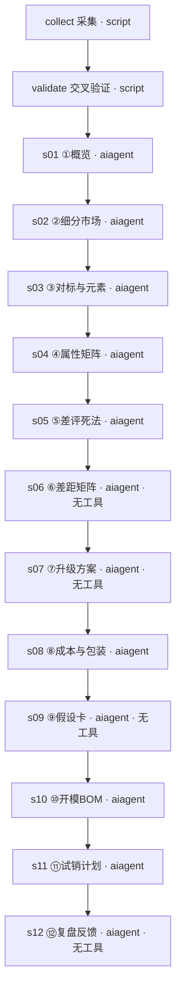
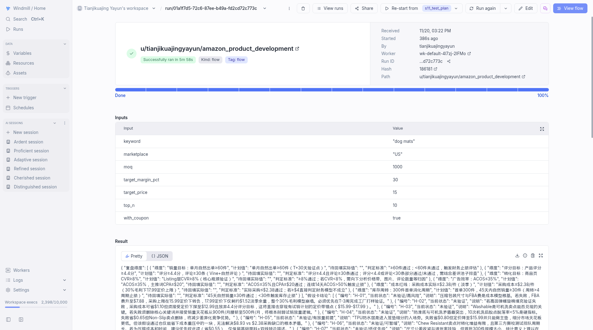

# 天机 AI × Windmill · 亚马逊产品开发跑通全流程

这是一条已经在 Windmill Cloud 上跑通的选品 Flow，不是官方教程的改写。

- Flow 路径：`u/tianjikuajingyayun/amazon_product_development`
- Workspace：`tianjikuajing-yayun`
- 部署版本：`v186181`（运行页上的 Hash 就是 `186181`）
- 模型：12 个 AI 步骤全部是 `deepseek` / `deepseek-v4-pro`，Resource 为 `$res:u/tianjikuajingyayun/ecstatic_deepseek`
- 实证案例：`dog mats`，美国站

本目录里的 OpenFlow、TypeScript、提示词、耗时和报错，都来自这次导出和已核对的排错记录。官方没写到的 Windmill 行为，正文会标明「本次导出 / 本次运行里看到的」，不把它们写成官方文档。

回到知识库首页：[../README.md](../README.md)。

## 这条 Flow 在做什么

业务目标：给定一个品类关键词，先用确定性代码把三方市场数据采集齐、对齐口径，再让 12 个分阶段 AI Agent 走完「市场能不能做 → 产品怎么定义 → 差评会死在哪 → 成本和包装 → 假设怎么证伪 → BOM 和试销 → 复盘模板」。

数据源分工写死在采集脚本里，下游不许换源：

| 指标 | 采信源 | 工具 |
| --- | --- | --- |
| 销量 | SIF | `ops_get_asin_sales_list` |
| 销售额 | 卖家精灵 | `product_research`（`revenue` / `units`，按月） |
| coupon / 优惠 | 卖家精灵里的 Keepa 口径 | `asin_detail_with_coupon_trend` |
| 竞品发现 | SIF | `market_get_keyword_root_competitors` |

偏差只用来判断「这行数能不能拿来做决策」，不用来改采信源。规则的实现见 [01-windmill-architecture-and-design.md](./01-windmill-architecture-and-design.md)。

## 实证输入

`dog mats` 这次运行页上的 Input，和 Flow schema 的默认值一致（`keyword` 无默认值，`target_price` 在 schema 里也没有默认值，这次显式传了 `15`）。

| 参数 | 这次的值 | schema |
| --- | --- | --- |
| `keyword` | `dog mats` | string，必填。说明文案举例是 `yoga mat` |
| `marketplace` | `US` | string，默认 `US` |
| `moq` | `1000` | number，默认 `1000`，说明是「首单与开模起订量」 |
| `target_margin_pct` | `30` | number，默认 `30`，目标毛利率（%） |
| `target_price` | `15` | number，无默认值，目标售价（美元） |
| `top_n` | `10` | number，默认 `10`，采样父体数量 |
| `with_coupon` | `true` | boolean，默认 `true`，是否拉 Keepa 口径 coupon 趋势 |

`collect` 还有一个脚本参数 `node_id_path`，Flow 里用静态空字符串传入。空字符串会走卖家精灵 `product_node` 自动选类目，不需要调用方填节点。

## 14 步执行顺序

OpenFlow 的 `modules` 是一条没有分支的链。`value.groups` 只是编辑器里的色块分组，不改变执行顺序。

数据不是只传给「下一步」。例如 `s12` 同时读 `s09`、`s11`、`s08` 和 `validate` 的可信度摘要。每一步具体引用了哪些 `results.*` / `flow_input.*`，写在 [02-14-step-pipeline-reference.md](./02-14-step-pipeline-reference.md)。

分组（导出 JSON 里的 `groups`）：

| 色块 summary | 从 | 到 |
| --- | --- | --- |
| 数据底座（采集 + 交叉验证） | `collect` | `validate` |
| 市场判定 ①-② | `s01_overview` | `s02_segments` |
| 产品定义 ③-④ | `s03_benchmark` | `s04_attr_matrix` |
| 痛点与差距 ⑤-⑦ | `s05_death_modes` | `s07_upgrade_plan` |
| 成本与假设 ⑧-⑨ | `s08_cost_packaging` | `s09_hypothesis_cards` |
| 落地 ⑩-⑪ | `s10_bom` | `s11_test_plan` |
| 复盘 ⑫ | `s12_review` | `s12_review` |

## 实测耗时

逐步耗时是这次链路核对下来的步骤用时。`s08` 的记录是「1 分钟」，没有秒的小数。

| 步骤 | 耗时 | 折成秒 |
| --- | --- | --- |
| `collect` | 5.925s | 5.925 |
| `validate` | 0.158s | 0.158 |
| `s01_overview` | 47.691s | 47.691 |
| `s02_segments` | 6m 19s | 379 |
| `s03_benchmark` | 2m 31s | 151 |
| `s04_attr_matrix` | 4m 25s | 265 |
| `s05_death_modes` | 1m 2s | 62 |
| `s06_gap_matrix` | 24.981s | 24.981 |
| `s07_upgrade_plan` | 49.701s | 49.701 |
| `s08_cost_packaging` | 1m | 60 |
| `s09_hypothesis_cards` | 36.09s | 36.09 |
| `s10_bom` | 37.52s | 37.52 |
| `s11_test_plan` | 48.815s | 48.815 |
| `s12_review` | 37.652s | 37.652 |

把上表相加：14 步合计 **1205.533 秒（约 20.1 分钟）**；其中 `s05`～`s12` 合计 **356.759 秒（5 分 57 秒）**。

运行页绿条写的是 **Successfully ran in 5m 58s**，进度 **100%**。这 5 分 58 秒是续跑段 `s05`～`s12` 的墙钟，比步骤耗时相加多出来的大约 1 秒是步骤之间的调度，不是另一次全量重跑。从头跑完 14 步的墙钟，这次截图没有单独给出。

`s12_review` 自己的模型 token（不是 exec）：`input_tokens` 7799，`output_tokens` 2087，`total_tokens` 9886，`cache_read_input_tokens` 0。可读复盘见 [examples/dog-mats-us-s12-review.md](./examples/dog-mats-us-s12-review.md)。

## 跑通截图

下面这张图是 Windmill 运行页：路径 `u/tianjikuajingyayun/amazon_product_development`，Hash `186181`，状态 Successfully ran in 5m 58s / 100%，Input 为上表那 7 个参数。左侧 Workspace execs 显示 **2,398/10,000**。Received 为 11/20, 03:22 PM，Started 386s ago，执行人 `tianjikuajingyayun`。地址栏里的 run id 以 `01a1f7d5` 开头，和本目录结果文件名一致。

顶部有 **Re-start from** 控件，截图里停在 `s11_test_plan`。那是页面上可选的续跑起点，不是「这次 5 分 58 秒只执行了 s11」。和步骤耗时对得上的续跑段是 `s05`～`s12`。

## 本专题索引

| 文件 | 内容 |
| --- | --- |
| [01-windmill-architecture-and-design.md](./01-windmill-architecture-and-design.md) | Code + AI Agent 为什么这样拆、口径与采信、MCP 裁剪、Resource 隔离、续跑和配额 |
| [02-14-step-pipeline-reference.md](./02-14-step-pipeline-reference.md) | 14 个模块的输入、模型、工具、职责、耗时 |
| [03-troubleshooting-and-evolution.md](./03-troubleshooting-and-evolution.md) | `v180115` 到 `v186181` 的 6 次排错，含 `reasoning_content` 风险 |
| [04-prompts-catalog.md](./04-prompts-catalog.md) | `s01`～`s12` 的 System Prompt 与 User Prompt 表达式原文 |
| [05-reproduce-in-your-workspace.md](./05-reproduce-in-your-workspace.md) | 在自己的 workspace 建 3 个 Resource、部署 2 个脚本、导入 Flow、试跑和续跑 |
| [flow/amazon_product_development.v186181.flow.json](./flow/amazon_product_development.v186181.flow.json) | `v186181` 的 OpenFlow。已核对：没有 API Key、token、邮箱 |
| [scripts/collect_market.ts](./scripts/collect_market.ts) | `u/tianjikuajingyayun/collect_market` |
| [scripts/cross_validate.ts](./scripts/cross_validate.ts) | `u/tianjikuajingyayun/cross_validate` |
| [examples/dog-mats-us-s12-review.md](./examples/dog-mats-us-s12-review.md) | `dog mats` 复盘的可读版 |
| [examples/run-01a1f7d5-result.json](./examples/run-01a1f7d5-result.json) | `s12_review` 的 Result JSON |
| [assets/20-flow-success.png](./assets/20-flow-success.png) | 上图原文件 |

导入前先读复现指南：导出文件里的 `u/tianjikuajingyayun/...` 要换成你自己的路径，密钥只放在 Resource 里。
